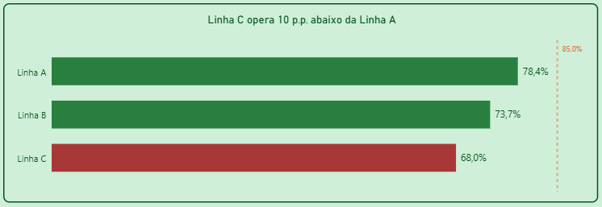
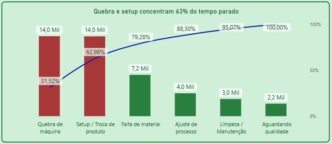
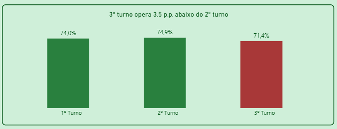
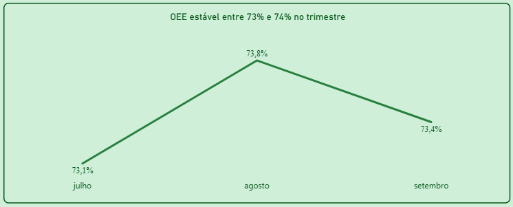
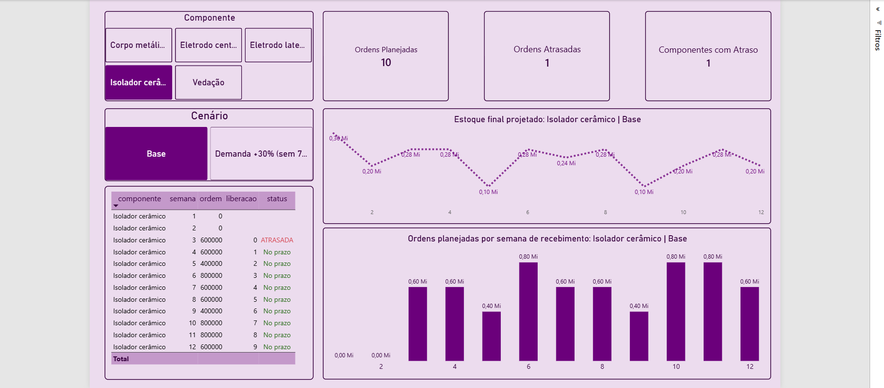

# PCP Mini Fábrica: do plano à execução

Projeto de portfólio que simula uma fábrica de velas de ignição (3 linhas, 3 turnos) para praticar,
de ponta a ponta, os principais conceitos de Planejamento e Controle da Produção (PCP).

## Problema
> A direção quer saber onde a fábrica perde eficiência e se a capacidade atual suporta o crescimento da demanda.

## Módulos
| # | Módulo | Status |
|---|--------|--------|
| 1 | OEE e Pareto de paradas | Concluido |
| 2 | MRP (necessidade de materiais) | Em Andamento |
| 3 | MPS, lead time e capacidade (gargalo) | A fazer |
| 4 | Kanban e plano vs. realizado | A fazer |

## Módulo 1: OEE
**Fórmulas**
- Disponibilidade = tempo operando / tempo planejado
- Desempenho = (peças produzidas x ciclo ideal) / tempo operando
- Qualidade = peças boas / peças produzidas
- **OEE = Disponibilidade x Desempenho x Qualidade**

**Premissas**
- 90 dias, 3 turnos de 480 min, 3 linhas (ciclos ideais de 2,0 / 2,5 / 3,0 s)
- Dados fictícios gerados com semente fixa (reprodutível)
- Paradas classificadas como planejadas e não planejadas

**Insigth**
- Linha C opera com OEE de 68%, 10 p.p. abaixo da Linha A. Recomenda-se investigar a velocidade real da linha (desempenho de 80%).
- 3º turno opera 3,5 p.p. abaixo do 2º turno.
- Quebra e setup concentram 63% do tempo parado.

**Como rodar**
```
pip install -r requirements.txt
python python/01_gerar_dados_oee.py
python python/02_calcular_oee.py
```

## Resultados 
- OEE por linha, turno e evolução diária
- Pareto de paradas! 
- Principais insights e recomendações! 

## Aprendizados

**Módulo 1 (OEE)**
- Entendi na prática que o OEE agregado deve ser calculado com média ponderada (soma do tempo e das peças), e não pela média simples dos percentuais de cada turno.
- Descobri que a maior perda da fábrica simulada vem do desempenho (15,1 p.p.), mais que da disponibilidade (11,4 p.p.), algo que o Pareto de paradas sozinho não mostra.
- Apliquei DAX com variáveis (VAR) para construir as medidas de Disponibilidade, Desempenho, Qualidade e OEE.
- Resolvi um problema real de qualidade de dados: o separador decimal dos CSVs era lido de forma errada no Power BI em português, o que corrompia as medidas. Aprendi a conferir os totais antes de montar visuais.
- Treinei storytelling com dados: títulos com insight, destaque só no que é problema e meta de 85% como referência.

## Módulo 2: MRP

**Fórmulas (por componente e por semana)**

- Necessidade bruta (NB) = demanda de velas x quantidade por vela
- Disponível = estoque inicial + recebimento programado
- Necessidade líquida (NL) = máximo entre 0 e (NB + estoque de segurança - disponível)
- Ordem planejada = NL arredondada para cima ao múltiplo do lote
- Estoque final = disponível + ordem - NB
- Liberação = semana de recebimento - lead time (ATRASADA se for semana 0 ou anterior)

**Premissas**

- 12 semanas de demanda (540 a 720 mil velas por semana) e 5 componentes, com lead time de 1 a 4 semanas
- Lote múltiplo e estoque de segurança por componente, e recebimentos já programados
- Cenário comparado: demanda +30% a partir da semana 7

**Insights (cenário base)**

- 5 ordens já nascem atrasadas, em 4 componentes. O eletrodo central é o caso mais crítico: a ordem da semana 2 deveria ter sido liberada 2 semanas antes, por causa do lead time de 4 semanas.
- Os estoques encostam no estoque de segurança várias vezes (eletrodo lateral em 7 semanas, corpo metálico em 5), então o lote múltiplo deixa pouca folga.

**Dashboard de MRP (Power BI)** — cenário base, isolador cerâmico



**Cenário +30%**

- O volume a comprar sobe entre 17% e 25% por componente; a vedação cresce 3 milhões de peças (de 12 para 15 milhões).
- O número de ordens atrasadas não muda: o atraso vem do estoque e do lead time iniciais, e não do aumento de demanda.

**Como rodar**

    python python/04_mrp.py
